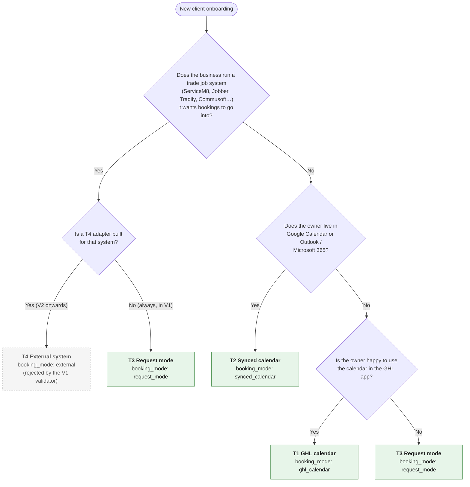

# Booking tier decision tree (T-806)

Use this at onboarding to choose how the receptionist books jobs for a client, and to fill in
`booking_mode` in `config/clients/<client>.yaml`. The questions come from the Build Plan
("Choosing a tier at onboarding"); the same help text is in the
[intake form](intake-form.md) §6.1. Anything marked **⚠ verify** is not yet confirmed in GHL.

Date: 2026-10-13.

---

## 1. Decision tree

Ask the questions in this order and stop at the first "yes".



Notes:

- **In V1 the first question always ends in T3.** T4 is "contract and one mapping document"
  only ([servicem8-jobber-mapping.md](../integration/servicem8-jobber-mapping.md)); the config
  validator rejects `booking_mode: external` with: _"external (T4) adapters are not built in V1;
  use request_mode until then"_ (`config/schema/business-config.ts`, decision D6).
- A client with a general CRM (not a trade job system) still uses T1–T3 for booking; CRM sync
  is a separate V2 adapter (Build Plan).
- If a T2 calendar sync turns out not to block slots reliably (spike item V5, **⚠ verify**), the
  plan's fallback is **T2 → T3**.
- If the owner is unsure between T1 and T3, prefer **T3**: a request the owner confirms is safer
  than a live booking into a diary nobody looks at.

---

## 2. What each tier needs at onboarding

|                                      | **T1 GHL calendar**                                                                                                    | **T2 Synced calendar**                                                                                                                                                                                                                                                         | **T3 Request mode**                                                                                                                                                                                                                                                                         | **T4 External** (not V1)                                                                        |
| ------------------------------------ | ---------------------------------------------------------------------------------------------------------------------- | ------------------------------------------------------------------------------------------------------------------------------------------------------------------------------------------------------------------------------------------------------------------------------ | ------------------------------------------------------------------------------------------------------------------------------------------------------------------------------------------------------------------------------------------------------------------------------------------- | ----------------------------------------------------------------------------------------------- |
| Client has                           | No calendar, happy to use the GHL app                                                                                  | Google Calendar or Outlook/Microsoft 365                                                                                                                                                                                                                                       | Only a mobile phone (or a job system, until T4 exists)                                                                                                                                                                                                                                      | ServiceM8, Jobber, Tradify, Commusoft or similar                                                |
| `booking_mode`                       | `ghl_calendar`                                                                                                         | `synced_calendar`                                                                                                                                                                                                                                                              | `request_mode`                                                                                                                                                                                                                                                                              | `external` → **rejected in V1**; use `request_mode`                                             |
| `calendar_id`                        | **Required** (GHL calendar id)                                                                                         | **Required** (the GHL calendar that is synced)                                                                                                                                                                                                                                 | Not needed                                                                                                                                                                                                                                                                                  | Not used (adapter settings instead)                                                             |
| `appointment_types`                  | **At least one** `{code, duration_minutes}`                                                                            | **At least one**                                                                                                                                                                                                                                                               | Optional (not used for live booking)                                                                                                                                                                                                                                                        | Would map to the external system's job categories                                               |
| `min_booking_notice_minutes`         | Set (e.g. 120)                                                                                                         | Set                                                                                                                                                                                                                                                                            | Not used for live booking                                                                                                                                                                                                                                                                   | Would apply                                                                                     |
| `cancellation_policy`                | Optional sentence                                                                                                      | Optional sentence                                                                                                                                                                                                                                                              | Optional sentence                                                                                                                                                                                                                                                                           | Optional sentence                                                                               |
| Calendar set-up in GHL               | Create calendar; availability = `opening_hours`; owner (and staff) assigned **⚠ verify** staff assignment needs        | Create GHL calendar and **connect the owner's Google/Outlook account**; set the owner's calendar as a **conflict calendar** so personal events block slots; choose which calendar new bookings are written to **⚠ verify** exact GHL option names and that blocking works (V5) | None for booking                                                                                                                                                                                                                                                                            | None in GHL; adapter credentials (OAuth/API key), staff list, category map in config (proposal) |
| Sync to test before go-live          | Book, reschedule and cancel a test job in GHL app                                                                      | Put a personal event in the owner's calendar → confirm that slot is **not** offered; book → confirm it appears in Google/Outlook; reschedule/cancel both ways                                                                                                                  | Owner SMS round trip (below)                                                                                                                                                                                                                                                                | n/a                                                                                             |
| How the agent books                  | Live: offers real slots and books (native Voice AI booking action)                                                     | Live, same as T1                                                                                                                                                                                                                                                               | Takes **two preferred windows**; nothing is booked on the call                                                                                                                                                                                                                              | Live, via middleware adapter                                                                    |
| Agent says                           | "You're booked for …" only after a confirmed booking                                                                   | Same                                                                                                                                                                                                                                                                           | "I'll pass those times to {owner}; he'll confirm by text" — never "booked"                                                                                                                                                                                                                  | Same as T1                                                                                      |
| Outcome code on success              | `BOOKED`                                                                                                               | `BOOKED`                                                                                                                                                                                                                                                                       | `BOOKING_REQUESTED`                                                                                                                                                                                                                                                                         | `BOOKED`                                                                                        |
| Reschedule / cancel by phone         | Via the middleware booking actions (GHL Calendars API); reschedule/cancel on native action still to test **⚠ verify**  | Same as T1                                                                                                                                                                                                                                                                     | Message taken for owner (`MESSAGE_TAKEN` / `CALLBACK_REQUESTED`)                                                                                                                                                                                                                            | Via adapter                                                                                     |
| Owner habits required                | Checks the GHL app (or notifications) for new bookings; keeps the GHL calendar up to date — blocks time off **in GHL** | Keeps **their own** calendar up to date as normal; nothing new to learn                                                                                                                                                                                                        | **Replies to the confirmation SMS promptly**: "YES" to accept, or texts another time. Reminder after 60 min without a reply (WF-07). Until spike V14 confirms GHL can tie the reply to the right customer, the owner confirms by ringing/texting the customer from the GHL app **⚠ verify** | Keeps the job system up to date as normal                                                       |
| SMS to `alert_sms_number`            | New booking alert (WF-02/WF-05)                                                                                        | Same                                                                                                                                                                                                                                                                           | Request to confirm (WF-07) + enquiry alert (WF-05)                                                                                                                                                                                                                                          | Same as T1                                                                                      |
| System of record for the appointment | GHL                                                                                                                    | GHL, mirrored to owner's calendar                                                                                                                                                                                                                                              | GHL (contact + pipeline "Awaiting confirmation")                                                                                                                                                                                                                                            | External system; GHL keeps the call record                                                      |
| Main risk                            | Owner forgets the GHL calendar exists → double-booking with their head/paper diary                                     | Sync lag or wrong conflict calendar → slot offered that is actually taken                                                                                                                                                                                                      | Owner doesn't reply → customer left waiting (WF-07 reminder, WF-08 callback deadline)                                                                                                                                                                                                       | Not built                                                                                       |

Middleware behaviour: `call-context` returns `can_book_live: true` only for `ghl_calendar` and
`synced_calendar`. For any booking error or timeout the agent falls back to request mode
(Build Plan middleware rules), so **every** client — whatever its tier — must have the T3 owner
SMS loop working (`alert_sms_number`, WF-07).

---

## 3. Config examples

T1 (as in `config/clients/demo.yaml`):

```yaml
booking_mode: ghl_calendar
calendar_id: <GHL calendar id>
appointment_types:
  - { code: assessment, duration_minutes: 60 }
  - { code: small_repair, duration_minutes: 90 }
min_booking_notice_minutes: 120
cancellation_policy: We ask for 24 hours' notice to cancel, please.
```

T2 — identical keys, `booking_mode: synced_calendar`, and `calendar_id` is the GHL calendar the
owner's Google/Outlook account is connected to.

T3:

```yaml
booking_mode: request_mode
# calendar_id and appointment_types not required
```

T4 — **do not use in V1** (validation fails):

```yaml
booking_mode: external # rejected: "external (T4) adapters are not built in V1; use request_mode until then"
```

Validator rules that apply (`config/schema/business-config.ts`):

- `booking_mode` ∈ `ghl_calendar`, `synced_calendar`, `request_mode`, `external`; `external` is
  rejected.
- `ghl_calendar` and `synced_calendar` require `calendar_id` and at least one
  `appointment_types` entry.
- `appointment_types[].code` must be unique, lowercase, 2–40 characters; duration 15–480 minutes.
- `min_booking_notice_minutes`: 0–10080 (default 0).

Run `npm run validate:config` (`tools/validate-config.ts`) before pushing; it prints the
client id and booking mode for each valid file.

Provisioning caveat (from [runbook.md](runbook.md)): the DEMO provisioning tool creates its own
calendar from `opening_hours` and does not yet read `calendar_id` from the YAML; for
`synced_calendar` the Google/Outlook connection is a manual GHL step, and for `request_mode` the
booking action is still created. **⚠ verify** before onboarding a real T2 or T3 client that the
live agent's booking action and calendar match the chosen tier.

---

## 4. Changing tier later

- T3 → T1/T2: create/connect the calendar, add `calendar_id` and `appointment_types`, change
  `booking_mode`, validate, deploy, push custom values; run the tier's sync test above.
- T1/T2 → T3: change `booking_mode`; existing future appointments stay in the GHL calendar and
  must be handled by the owner.
- Any tier → T4 (V2): only once an adapter exists for that system; the prompt does not change.
- Record the change and the reason in the client's onboarding record.

---

## Sources

- Build Plan PDF: "Integration strategy for different client stacks", tier table, "Booking
  interface contract", "Choosing a tier at onboarding", "Middleware rules".
- `docs/V1_IMPLEMENTATION_PLAN.md` FR-21–FR-23, spike items V4, V5, V14.
- `docs/architecture.md` decision D6.
- `config/schema/business-config.ts`, `config/clients/demo.yaml`, `src/actions/call-context.ts`.
- `docs/ghl/workflows.md` (WF-07), `docs/ghl-capabilities.md` (native booking verified for
  book; reschedule/cancel still to test), `docs/onboarding/intake-form.md` §6,
  `docs/onboarding/runbook.md`.
- No external sources: GHL calendar sync option names are not checked here (**⚠ verify** in
  GHL help/our account).
